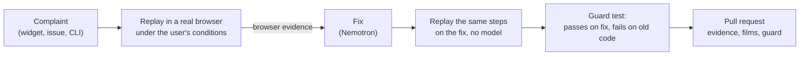

# Complaint Replay

Reproduce a user's bug report in a real browser under that user's own conditions, prove it with evidence the browser
recorded, and open a pull request with the fix and a regression test.

[](https://github.com/yashasviyadav30/complaint-replay/actions/workflows/ci.yml)
[](LICENSE)
[](pyproject.toml)
[](#models)

Complaint Replay ships as a **GitHub Action**, a **CLI** (`crp`) and an **MCP server** for coding agents, with an
optional self-hosted service that collects complaints from a one-line widget on your site.

[Live demo](https://yashasviyadav30.github.io/complaint-replay/) ·
[Try it on a real issue](https://github.com/yashasviyadav30/crp-demo-shopping-cart/issues/7) ·
[Real-bug benchmark](benchmarks/real-bugs.md)

<table>
<tr>
<th>The complaint, replayed on the user's 360&nbsp;px phone</th>
<th>The same steps on the fix it wrote</th>
</tr>
<tr>
<td></td>
<td></td>
</tr>
<tr>
<td colspan="2"><em>"I added everything to my cart but there is no button to pay."</em> Every frame is a step the agent took in a real browser. Both films go into the pull request.</td>
</tr>
</table>

## Why

A user writes *"OTP never comes"*, *"الزر لا يعمل"* or *"I use a screen reader and can't find the cart"*. A developer
tries it on a fast laptop, it works, and the report is closed as "can't reproduce". Studies of real bug trackers put
non-reproducible reports at 13-24% of all bug reports ([ICSME 2020](https://marco-c.github.io/publications/non_reproducibility-icsme2020.pdf)),
and a large share fail because the user's device, network or settings differ from the developer's.

Complaint Replay recreates those conditions instead of asking the developer to guess them.

## How it works



1. **Replay.** An agent drives Chromium or WebKit with the user's device, network, language, timezone, zoom, color
   scheme and input method. A screen-reader user is replayed through the accessibility tree only; a keyboard user
   gets only the keys a keyboard user has (Tab, Enter, Space, Escape, arrows). The browser is slowed down for real; the model is never asked to pretend.
2. **Prove.** Code watching the browser records evidence: failed requests, a control off screen, text in the wrong
   language, a button announced only as "1", a payment sent twice. The model may cite evidence. It cannot create it.
3. **Fix.** NVIDIA Nemotron reads the cited evidence, the app functions that ran in that step (Chrome code coverage)
   and the relevant source files, and writes the smallest patch on a new branch.
4. **Prove the fix.** The exact steps that showed the bug run again on the patched code, driven by code, not a model.
5. **Guard.** Those steps are saved as a test that must pass on the fix and fail on the old code. It runs in CI on
   every later pull request.
6. **Report.** The pull request carries the evidence, the guard and two films (the bug, then the fix). The person who
   complained sees "fixed" in the widget.

Your source code stays in your own CI. The optional server receives evidence, steps and verdicts, never code.

## Quick start

### GitHub Action

```bash
uvx --from git+https://github.com/yashasviyadav30/complaint-replay crp init
```

`crp init` writes `complaint-replay.toml` (how to start your app) and `.github/workflows/complaint-replay.yml`. Then:

1. Set `start` in `complaint-replay.toml` and add your app's install step to the workflow.
2. Add `NVIDIA_API_KEY` (free at [build.nvidia.com](https://build.nvidia.com)) or `NEBIUS_API_KEY` as a repository secret.
3. In **Settings > Actions > General**, allow GitHub Actions to create pull requests.

The workflow replays a complaint when you:

- label an issue `replay` (add `mobile`, `iphone`, `screen-reader`, `keyboard`, `elderly`, `hindi`, `arabic`,
  `slow-network` or `train` to pick the user),
- comment `/replay [user] what went wrong` on an issue (capped per day with `daily-limit`),
- start it by hand from the Actions tab, or
- receive a complaint from the Complaint Replay server (`repository_dispatch`).

On every push and pull request it runs all saved guards.

### CLI

```bash
uv tool install git+https://github.com/yashasviyadav30/complaint-replay
crp setup                                          # installs Chrome's and Safari's engines

crp replay "Pay button is missing on my phone" --device "Galaxy S9+" --network slow-3g
crp replay "الدفع لا يعمل" --user arabic --fix --pr  # reproduce, fix, prove, guard, open a PR
crp guard                                          # run every guard test, as CI does
```

### MCP server for coding agents

```bash
uv tool install "complaint-replay[mcp] @ git+https://github.com/yashasviyadav30/complaint-replay"
claude mcp add complaint-replay -- crp mcp          # Cursor and other MCP clients take the same command
```

The agent gets `replay_complaint`, `run_guards` and `find_devices`, so it can reproduce a bug as the user, change the
code, and rerun the guard until it passes.

### Server, widget and dashboard (optional)

```bash
docker compose up        # API, dashboard, widget and a demo shop on http://localhost:8200
```

```html
<script src="https://YOUR-SERVER/widget.js" data-project="crp_your_key" defer></script>
```

The widget adds "Report a problem" to your site in 17 languages, typed or spoken. With each complaint it sends the
user's real screen, device, network, language, timezone and display settings, plus silent signals (rage clicks, page
errors, failed or slow requests). The server masks personal data, groups duplicates across languages, triggers your
workflow and shows each case on a board. Hosting: see [DEPLOY.md](DEPLOY.md).

## Reference

### Action inputs

| Input | Default | Description |
|---|---|---|
| `mode` | `guard` | `replay` reproduces, fixes and opens a PR; `guard` runs every guard test |
| `complaint` | | What the user said, when started by hand |
| `user` | `slow_3g_android` | A ready-made user (see below) |
| `fix` | `true` | Also fix, prove, guard and open a pull request |
| `nvidia-api-key` | | build.nvidia.com key, used when no Nebius key is set |
| `nebius-api-key` | | Nebius Token Factory key |
| `github-token` | `github.token` | Pushes the fix branch and opens the pull request |
| `daily-limit` | `20` | Most `/replay` comment runs per day (UTC); `0` for no limit |
| `payload` | | Complaint JSON from the server (`repository_dispatch`) |

### CLI commands

| Command | What it does |
|---|---|
| `crp replay "<complaint>"` | Replay as a user. Conditions: `--user`, `--device`, `--network`, `--locale`, `--timezone`, `--dark`, `--reduced-motion`, `--forced-colors`, `--zoom`, `--keyboard`, `--screen-reader`. Target: `--repo` or `--url`. Then `--fix`, `--pr`, `--base`, `--issue` |
| `crp guard` | Run every guard; `--base <ref>` also checks that new guards fail on that ref |
| `crp auth --url <site>` | Log in once by hand; the agent reuses the saved session |
| `crp devices [filter]` | List the 207 device profiles |
| `crp init` | Add `complaint-replay.toml` and the workflow to a repo |
| `crp setup` | Install the browser engines |
| `crp mcp` | Serve the tools above over MCP (stdio) |

### Ready-made users

| `--user` | Who | How it is enforced |
|---|---|---|
| `slow_3g_android` | Cheap Android phone on slow 3G | 360 px device profile, added latency per request |
| `iphone` | iPhone in Safari | WebKit, Safari's own engine, with an iPhone profile |
| `elderly` | Older first-time user at 200% zoom | Reads before each step, types one key at a time |
| `screen_reader` | Blind user | Sees only the accessibility tree; can use only named controls |
| `keyboard` | No mouse | Tab, Enter, Space, Escape and arrows only |
| `hindi`, `arabic` | Phone set to Hindi or Arabic | Browser locale and timezone; right-to-left layout checked |
| `train` | Signal drops mid-payment | The payment reaches the server but its reply is lost |
| `flaky_network` | Unreliable mobile data | A quarter of requests fail |
| `fast_desktop` | A developer's laptop | Control case |

Networks: `wifi`, `4g`, `3g`, `slow-3g`, `2g`, `satellite`, `flaky`, `tunnel`, `drops`. Complaints from the widget
carry the real user's measured conditions. When the user states a need in any language ("I use a screen reader",
"मुझे बड़े अक्षर चाहिए"), Nemotron reads it and the replay applies it too.

### Evidence

| Area | What the browser records |
|---|---|
| Network and speed | failed requests, HTTP errors, slow requests, slow pages and layout jumps (web vitals), spinners stuck for 15 s, redirect loops |
| Layout | controls off screen or covered, text cut off, page wider than the screen, missing images, right-to-left pages laid out left-to-right |
| Interaction | taps that did nothing, taps something else intercepted, typed values that vanish, Enter choosing a different option, date pickers that never open, a code or session that expired before a slow user finished |
| Accessibility | axe-core violations (WCAG 2.2 AA), unclear names ("1", "+"), invisible focus, controls a keyboard can't reach, plus the page as a screen reader announces it |
| Language | messages not in the user's language (fastText language ID) |
| Money | amounts that disagree between API calls, the same payment sent twice, a retry that charges twice |
| Your own rules | JavaScript files listed under `checks`, each returning problems ("the invoice total doesn't match its lines") |

### Configuration

`complaint-replay.toml` at the repo root:

```toml
[app]
start = "npm run dev -- --port {port}"   # how to start the app; {port} is filled in
ready = "/"                              # path that answers once the app is up
ready_text = "Sign in"                   # optional: text shown once the app is usable
hints = "Test login: demo@example.com"   # optional: what a new user would need to know
edit = ["src/**"]                        # files the fixer may change
checks = ["checks/invoice.js"]           # optional: your own evidence rules
auth = ".complaint-replay/auth.json"     # optional: a session saved with `crp auth`
```

### Environment variables

| Variable | Purpose |
|---|---|
| `NVIDIA_API_KEY` / `NEBIUS_API_KEY` | Model access: NVIDIA API catalog or Nebius Token Factory |
| `REPLAY_BASE_URL`, `REPLAY_API_KEY` | Any OpenAI-compatible server instead (vLLM, NVIDIA NIM, Ollama) |
| `REPLAY_MODEL`, `FIX_MODEL` | Override the models picked from the provider's catalog |
| `REPLAY_TOKEN_BUDGET` | Hard token cap per run, so a looping agent stops |
| `GITHUB_TOKEN` | Server: lets it start your workflow |
| `PUBLIC_URL` | Server: the address GitHub Actions can reach for progress callbacks |
| `DATABASE_URL` | Server: Postgres instead of the default SQLite |

The server can also use a GitHub App for sign-in and per-repo installs (`/setup/github-app` creates one from a
manifest). That path is built and unit-tested but has not been run against a live App yet; the token above is the
tested path.

## Results

**On code we did not write.** [WebDevSimplified/react-ts-shopping-cart](https://github.com/WebDevSimplified/react-ts-shopping-cart)
(MIT), copied unchanged. Three real accessibility bugs, three complaints, three guarded pull requests: a cart button
announced only as "1", quantity buttons announced as "+" and "−", product images without alt text. The last one ran
the full loop: widget, server, GitHub Actions, pull request, "fixed" back in the widget. Three bugs show the chain
works on unfamiliar code, not how often it works.

**On real bugs from a real product.** Eight bugs that [Actual Budget](https://github.com/actualbudget/actual) fixed
between August and October 2026, each put back by reversing the real fix and given to Complaint Replay as a
user-style complaint. Solved means fixed, guarded, and in a file the real fix also changed.

- **Solved: 1 of 8.** "When I tap the date, the calendar never opens" was reproduced, fixed in the same shared input
  component upstream changed, and guarded. Our fix shows the browser's calendar button; upstream opens the picker on
  tap. [Our diff](benchmarks/real-bugs-9071-our-fix.diff).
- **Results vary between runs.** In run 11 a lost-amount bug was fixed and guarded in the caller rather than the
  helper upstream fixed; in runs 13-15 it reproduced every time but the fix did not hold.
- **This is a development set, not a blind test.** We ran these 8 bugs 15 times and changed the engine after each
  run. The evidence that caught the date-picker bug was added after it failed in run 13, the app hints were written
  while watching the runs, and run 15 had a web-search step (since removed) whose query pointed at the calendar
  button. A fair score needs bugs the engine has never seen.

Every case, misses included, with what each one needs: [benchmarks/real-bugs.md](benchmarks/real-bugs.md).

**On planted bugs.** The demo shop has 7 planted bugs. Three runs each with `uv run python scripts/bench_demo.py 3`
(Oct 14, 2026): 21/21 reproduced, 20/21 fixed and proven, 20/21 guarded, 0 false alarms on the clean shop
([table](benchmarks/demo-shop.md)). Three later scenarios (iPhone in WebKit, an OTP that expires before a slow user
finishes, a retry that charges twice) each passed end to end on Windows and on Linux in GitHub Actions.

**Across languages.** Complaints in Hindi, Hinglish, Arabic, Tamil, Japanese and 15 more languages are grouped with
the same bug reported in English and sorted into bug, confusion, feature request or spam. This was checked on 400
complaints written by Nemotron, not real users, so it shows that nothing breaks across scripts, not real-world accuracy
([numbers](benchmarks/triage.md)).

## Models

| Job | Model |
|---|---|
| Navigate: one action at a time | Nemotron 3 Super, thinking off |
| Judge: does this evidence match the complaint? | Nemotron 3 Super, thinking off, with a second skeptic check per item |
| Read stated needs ("I'm blind") | Nemotron 3 Super |
| Fix | Nemotron 3 Super, reasoning on |
| Group duplicates across languages | Nemotron Embed, confirmed by Nemotron 3.5 Lightning |
| Triage | a small classifier on Nemotron Embed vectors, trained on CPU |
| Language ID | fastText lid.176, CPU |

All calls go through one OpenAI-compatible client (`replay/llm.py`). Every result above ran on NVIDIA's free API
catalog. With `NEBIUS_API_KEY` set, the same code calls Nebius Token Factory; model names are looked up in the
provider's catalog, so nothing else changes. The benchmarks have not been run on Token Factory.

## Privacy and security

- The widget never sends what users type into your forms. Emails, phone numbers, card and account numbers, PAN and
  Aadhaar are masked before storage and before any model sees them.
- Spoken complaints are turned into text by the browser's own speech service (in Chrome, Google's). The user checks
  the text before sending; no audio reaches Complaint Replay.
- Fixes land only on a new branch and pull request on the repo's own `origin`, committed as "Complaint Replay". The
  fixer may not edit tests, CI or secret files, and the app under test runs without your secrets.

Details and how to report a vulnerability: [SECURITY.md](SECURITY.md).

## Limitations

- Web apps only. Native mobile apps would need emulators.
- Fixes work best on small, local bugs: a label, a CSS rule, a timeout, a wrong variable. Larger refactors are out of
  scope; a proven bug the fixer can't solve becomes a GitHub issue with the guard as its acceptance test.
- The real-bug benchmark is 8 bugs on one app, used to develop the engine.
- Widget translations are machine-assisted.
- Pull requests opened with the default Actions token don't trigger your other workflows (a GitHub rule).

## Contributing

Setup, tests and conventions: [CONTRIBUTING.md](CONTRIBUTING.md).

## License

[Apache 2.0](LICENSE)
