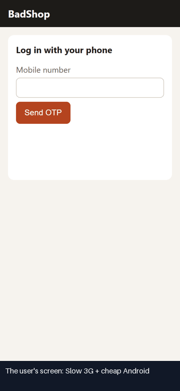

# Complaint Replay

**Your users already told you what's broken. Complaint Replay proves it, fixes it, and makes sure it never comes back.**

[](LICENSE)
[](#run-the-tests)
[](#how-nvidia-nemotron-and-nebius-are-used)
[](#set-it-up-on-your-app-about-10-minutes)

**[Live demo](https://yashasviyadav30.github.io/complaint-replay/)** · **[Try it yourself: comment `/replay` on this issue](https://github.com/yashasviyadav30/crp-demo-shopping-cart/issues/7)** · **[Real-bug benchmark, misses included](benchmarks/real-bugs.md)**

<table>
<tr>
<th>The user's complaint, replayed on their 360&nbsp;px phone</th>
<th>The same steps on the fix Complaint Replay wrote</th>
</tr>
<tr>
<td></td>
<td></td>
</tr>
<tr>
<td colspan="2"><em>"I added everything to my cart but there is no button to pay."</em> Every frame is a real step the AI twin took in a real browser; the films go into the pull request.</td>
</tr>
</table>

A customer writes *"OTP never comes!"*, *"الزر لا يعمل"* or *"I use a screen reader and can't find the cart"*. The developer tries it on a fast laptop, it works, and the complaint is closed as "can't reproduce". Studies of real bug trackers put that at 13-24% of all bug reports ([ICSME 2020](https://marco-c.github.io/publications/non_reproducibility-icsme2020.pdf)), and a large share fail because the user's device, network or settings differ from the developer's.

Complaint Replay turns the complaint into a pull request:

1. **Hears** it: a one-line widget on your site takes the complaint in any language, typed or spoken, plus silent signals (rage clicks, page errors, failed or slow requests), plus the user's real conditions: screen, device, network, language, timezone, dark mode, reduced motion.
2. **Reproduces** it: an AI twin opens a real browser **under those exact conditions** and repeats what the user did. If the user says they use a screen reader or only a keyboard, the twin does too.
3. **Proves** it with machine evidence only. The AI may only cite what code watching the browser recorded.
4. **Fixes** it: NVIDIA Nemotron reads the evidence and the relevant source files and writes the smallest fix.
5. **Proves the fix**: the exact steps that triggered the bug run again on the fixed code, by code, no model.
6. **Guards** it: those steps become a test that passes on the fix and fails on the old code, and runs in your CI on every pull request.
7. **Closes the loop**: a pull request with the evidence, the guard and two short films (captioned GIFs of the user's steps: the bug, then the same steps on the fix); the person who complained sees "fixed" in the widget, with a link to watch it working.

It runs inside **your own GitHub Actions**, so your source code never leaves your CI. Open source, Apache 2.0.

### What you won't find elsewhere

- **Conditions are real, not role-played.** 207 device profiles, slow and flaky networks, Hindi, Arabic right-to-left, 200% text, keyboard-only and screen-reader users. The browser is slow; the model is not told to pretend.
- **Hear what a blind user hears.** For screen-reader bugs, press *Listen* in the dashboard: the browser reads the page the way the user met it ("BadShop, heading level 1. Button."). Which button is the cart?
- **Every user, not just Chrome.** iPhone complaints replay in Safari's own engine; older users replay at their own pace, so the OTP that expires before they finish typing shows up; a train going into a tunnel mid-payment shows whether the user gets charged twice.
- **Speak the complaint.** Older users and people who'd rather not type tap the mic in the widget and talk, in their own language.
- **Watch it fixed.** The person who complained gets a link to the film of their own problem, now working.
- **Proof the model can't fake.** "Reproduced" needs evidence the browser recorded; a fix counts only when code replays the user's steps and the bug is gone.
- **Coding agents can drive it.** `crp mcp` gives Claude Code, Cursor or Copilot tools to replay a bug and run its guard until it passes.

Built for the Nebius x NVIDIA Global AI Hackathon (Coding and Agentic Engineering track).

## Set it up on your app (about 10 minutes)

1. **Add the widget** to your site, one tag before `</body>`:
   ```html
   <script src="https://YOUR-SERVER/widget.js" data-project="crp_your_key" defer></script>
   ```
2. **Add the workflow** to your repo. This writes `complaint-replay.toml` (how to start your app) and `.github/workflows/complaint-replay.yml`:
   ```bash
   uvx --from git+https://github.com/yashasviyadav30/complaint-replay crp init
   ```
   Set `start` in `complaint-replay.toml`, add `NVIDIA_API_KEY` (free at build.nvidia.com) or `NEBIUS_API_KEY` as a repository secret, and in Settings > Actions turn on *Allow GitHub Actions to create and approve pull requests*.
3. **Connect GitHub**: install the Complaint Replay GitHub App on the repo (one click from the dashboard's Set Up page), or for a single team set `GITHUB_TOKEN` on your server.
4. **Send a test complaint** from the Set Up page and watch it move across the board.

The dashboard walks you through the same four steps.

### Run the server

```bash
docker compose up          # API, dashboard, widget and the built-in demo shop on http://localhost:8200
```

Hosting it for a team: see [DEPLOY.md](DEPLOY.md) (a free Render blueprint and a slim image with no browser inside).
SQLite by default; set `DATABASE_URL=postgresql://...` for Postgres. Set `PUBLIC_URL` to the address GitHub Actions can reach (on Render it is set for you). GitHub login and per-repo installs need a GitHub App: open `/setup/github-app` and GitHub creates one from a manifest in one click (or set `GITHUB_APP_*` and `GITHUB_CLIENT_*`).

### Or use the command line

```bash
uv tool install git+https://github.com/yashasviyadav30/complaint-replay
crp setup                                                      # installs the browser
crp replay "Pay button is missing on my phone" --device "Galaxy S9+" --network slow-3g
crp replay "الدفع لا يعمل" --user arabic --fix --pr               # reproduce, fix, prove, guard, open a PR
crp guard                                                      # run every guard test (what CI runs)
crp auth --url https://staging.example.com                     # save a test login the twin reuses
crp devices pixel                                              # 207 device profiles
crp mcp                                                        # the same, as tools for coding agents (below)
```

## Works with the tools you already use

- **GitHub issues**: label a bug report `replay` (add `mobile`, `screen-reader`, `keyboard`, `hindi`, `arabic`... to pick the user). The Action replays the issue text and replies on the issue with the verdict, the proof and the pull request.
- **Support desks**: forward tickets from Zendesk, Intercom or an email bridge to the project's inbox address with its secret.
- **Sentry**: point an issue-alert webhook at the project's Sentry address; new errors arrive as silent signals.
- **Team chat**: a Slack-compatible webhook (Slack, Mattermost, Discord) hears when a bug is proven, fixed, or needs a person.
- **Coding agents**: when the automatic fix fails or doesn't hold, the proven bug becomes a GitHub issue with the evidence, the steps and the guard test as its acceptance check, ready for GitHub Copilot's coding agent or a teammate. Agents can also drive Complaint Replay directly over MCP: `claude mcp add complaint-replay -- crp mcp` (Claude Code; Cursor and others take the same command) gives them `replay_complaint`, `run_guards` and `find_devices`, so an agent can reproduce the bug as the user, change the code, and rerun the guard until it passes. Install with `uv tool install "complaint-replay[mcp] @ git+https://github.com/yashasviyadav30/complaint-replay"`. It can also go to Linear or Jira (set `LINEAR_API_KEY` or the `JIRA_*` values in the repo; built to their documented APIs, not yet tried against live accounts).
- **Your own model**: set `REPLAY_BASE_URL` and `REPLAY_API_KEY` to use any OpenAI-compatible server (vLLM, NVIDIA NIM, Ollama) instead of Token Factory.

Each project also has a kind of product. Government, health and education projects get accessibility checks for every user, strict masking of any long number, and no screenshots; payments projects get strict masking.

## What the twin can be

| Condition | How it is enforced (never role-played) |
|---|---|
| Any of 207 phones, tablets and desktops | Playwright's device catalog: screen, pixel ratio, touch, user agent |
| iPhone and iPad users, Safari | Run in WebKit, Safari's real engine, not Chrome dressed up; a complaint sent from an iPhone replays in it automatically |
| Network: 4g, 3g, slow-3g, 2g, satellite, flaky, drops, tunnel | Latency added per request; flaky fails every 4th request; drops cuts the connection after the page loads; on flaky and tunnel a payment reaches the server but its reply is lost, like a train going into a tunnel mid-payment |
| Any language and timezone, right-to-left | Browser locale and timezone; RTL layout is checked |
| Dark mode, forced colors, reduced motion, 200% text | Browser media settings and page zoom |
| Screen reader | The twin sees only the accessibility tree and can only use named controls |
| Keyboard only | The twin can only press Tab, Enter, Space and arrows |
| Older and slower users | The twin reads for a few seconds before each step and types one key at a time, so a code or session that expires too soon locks it out, as it locks them out |
| Interrupted users | The twin can press Back or reload mid-flow, as people do when something seems stuck |

Conditions come from the widget (measured on the real user's device) plus what the user says about themselves in the complaint (Nemotron reads "I use a screen reader" in any language).

## What counts as evidence

Code watching the browser records: failed requests, HTTP errors, console errors, slow requests, controls off screen or covered by something else, text cut off, the page wider than the screen, missing images, slow pages and layout jumps (web vitals), spinners stuck for 15 s, redirect loops, taps that did nothing at all, taps that something else intercepted, values the user typed that vanish after another tap, Enter saving a different option than the highlighted one, date fields whose picker never opens, messages not in the user's language (fastText language ID on CPU), right-to-left pages laid out left-to-right, invisible keyboard focus, things a keyboard can't reach, controls a screen reader announces only as "1" or "+", accessibility violations (axe-core, WCAG 2.2 AA), money values that disagree between API calls, the same payment sent twice, a payment accepted twice as two orders after the signal dropped, and a code or session that expired before a slow user finished. Teams can add their own rules too: list JavaScript files under `checks` in `complaint-replay.toml`, each a function returning problems ("the invoice total doesn't match its lines"), and they run on every replay and every guard. Every item says where on the page it happened ("in the navigation", "near 'Book $10.99'").

## Results

### On someone else's app, with real bugs we did not plant

[WebDevSimplified/react-ts-shopping-cart](https://github.com/WebDevSimplified/react-ts-shopping-cart) (MIT), copied unchanged into a demo repo. Three real accessibility bugs, three complaints, three guarded pull requests:

| Complaint | Found | Fix | Where it ran |
|---|---|---|---|
| "I use a screen reader... I can't find the cart button, it just says one" | Cart button announced only as "1" | `aria-label="Cart"` | Laptop, `crp replay --fix --pr` |
| "...the buttons next to the book only say plus and minus" | Quantity buttons announced as "+" and "−" | `aria-label` on both | GitHub Actions, started by hand |
| "I'm blind... the product pictures are not described at all" | `image-alt` violation on every product image | `alt` text on the images | Full loop: widget, server, GitHub Actions, PR, status back to the widget |

Each guard passed on the fix and failed on the old code when the pipeline checked it; for the first pull request the same check also ran in CI (`crp guard --base main`). Three is a small number: it shows the chain works on code we did not write, not how often it works.

### On real bugs from a real product, misses included

[Actual Budget](https://github.com/actualbudget/actual), an open-source budgeting app, fixed these 8 bugs between August and October 2026. For each one we put the bug back by reversing the real fix, gave Complaint Replay only a complaint written like a user would write it, and let it run in GitHub Actions ([`real-bugs.yml`](.github/workflows/real-bugs.yml)). The real fix is the answer key.

Latest full run (run 15, Oct 17, Nemotron 3 Super, [table](benchmarks/real-bugs.md)):

- **Solved, strict: 1 of 8.** Fixed, guarded, and in a file the real fix also changed. "On my Android phone, when I tap the date, the calendar never opens" was reproduced (the date field's picker did not open and the field showed no picker button), fixed in the same shared input component the Actual developers changed, and guarded: the user's steps fail on the old code and pass on ours. Our fix differs from theirs: it shows the browser's calendar button on date fields, while upstream opens the picker when the field is tapped. [Read our diff](benchmarks/real-bugs-9071-our-fix.diff).
- **Fixed and guarded in any file: 1 of 8** (the same case).
- **Results vary from run to run.** In run 11, "I type the amount, tap Cleared, and it disappears" was fixed and guarded in the caller rather than in the helper upstream fixed ([that diff](benchmarks/real-bugs-8733-our-fix.diff)); in runs 13-15 it reproduced every time but the fix did not hold. One run of 8 bugs is a small sample: read the numbers as "it can", not as a rate.

The first runs scored 0 for bad reasons: the twin wandered, and the judge accepted "page loaded slowly" or a tap on a greyed-out field as proof. Each miss became a fix with a test (33 fix commits since Oct 16): a disabled control or a tap behind an open menu is never proof; the twin's own claims go through the judge; the fixer may never edit tests; a rejected patch gets a second round with what the proof saw; switches drawn as labels and focusable `div`s count as controls; new evidence catches date fields whose picker never opens. Four of the eight need things no general check can see (a missing option, an app-specific balance, a lock icon, a non-current month); the [table](benchmarks/real-bugs.md) says which and why.

### On the demo shop, 7 planted bugs, 3 runs each

Measured Oct 14, 2026 with `uv run python bench.py 3` (NVIDIA API catalog endpoint, Nemotron 3 Super):
**21/21 reproduced, 20/21 fixed and proven, 20/21 guarded, 0 false alarms** on the clean shop ([per-bug table](benchmarks/demo-shop.md)). These are bugs we planted ourselves: a working demonstration, not a broad benchmark.

Added Oct 19 and run once each end to end (all three reproduced, fixed and guarded): the Pay button off an iPhone 15's screen, replayed in Safari's engine; an OTP that expires after 10 seconds, met by the slow older user; and a retry after a dropped signal that charges twice. One run each is a demonstration, not a rate.

### Any language

On 400 complaints in 20 languages and scripts (Hindi, Hinglish, Arabic, Urdu, Bengali, Tamil, Telugu, Marathi, Swahili, Japanese, Chinese and more), **written by Nemotron, not by real users**:

- Same bug, different language: the nearest complaint in another language is the same bug **97%** of the time (99% within the top 3 that grouping verifies).
- Triage (bug, confusion, feature request, spam): **98%** on a held-out half, with a small model trained on a laptop CPU. It is weak on wishes about topics it never saw; details in [benchmarks/triage.md](benchmarks/triage.md).

Treat these as a check that nothing breaks across scripts. Real complaints are messier.

## How NVIDIA Nemotron and Nebius are used

| Job | Model | Ran on (all results here) |
|---|---|---|
| Navigator: one click or keystroke at a time | Nemotron 3 Super (thinking off) | NVIDIA API catalog (free tier) |
| Judge: does this evidence match the complaint? | Nemotron 3 Super (thinking off) | NVIDIA API catalog (free tier) |
| Stated needs: screen reader, keyboard, bigger text | Nemotron 3 Super | NVIDIA API catalog (free tier) |
| Fixer: reads evidence + the relevant source files, writes the patch | Nemotron 3 Super (reasoning on) | NVIDIA API catalog (free tier) |
| Duplicate grouping | Nemotron Embed + Nemotron 3.5 Lightning check | NVIDIA API catalog (free tier) |
| Triage: bug, confusion, feature request, spam | Small model on Nemotron Embed vectors | CPU, trained on a laptop |
| Language ID of complaints and page text | fastText lid.176 (GlotLID optional) | CPU |
| Research before the fix | Tavily search API | Tavily |

All model calls go through one OpenAI-compatible client (`replay/llm.py`). Everything in this README ran on NVIDIA's free API catalog (`NVIDIA_API_KEY`). Set `NEBIUS_API_KEY` instead and the same code calls **Nebius Token Factory**: model names are looked up in the provider's own catalog, so nothing else changes. We have not run the benchmark on Token Factory. A hard token budget per run (`REPLAY_TOKEN_BUDGET`) stops a looping agent.

## How it fits together

```mermaid
flowchart LR
    U["User on their own phone"] -->|"complaint in any language<br/>+ real conditions"| W["widget.js"]
    W --> S["Complaint Replay server<br/>PII masked, language ID, triage, grouping"]
    S -->|"repository_dispatch"| A["Your GitHub Action"]
    A --> T["AI twin in a real browser<br/>with the user's device, network, language"]
    T -->|"machine evidence only"| F["Nemotron fix on a branch"]
    F --> P["Same steps replayed on the fix"]
    P --> G["Guard test: passes on fix,<br/>fails on old code"]
    G --> PR["Pull request with evidence,<br/>screenshots, guard"]
    A -. "progress, signed" .-> S
    S -. "status" .-> W
```



## Privacy and security

- Users can speak a complaint instead of typing it. The browser's own speech service turns it into text (in Chrome, that service is Google's) and the user checks the text before sending; no audio reaches Complaint Replay.
- The widget never sends what users type into your forms, only button names. Emails, phone numbers (digits in any script), card and account numbers, PAN and Aadhaar are masked before storage and before any model sees them.
- Your source code stays in your CI; the server receives evidence, steps and verdicts. Screenshots live in the pull request branch.
- Fixes only ever land on a new branch and a pull request, committed as "Complaint Replay", never as a person, and only to the repo's own `origin`.
- Each project can limit which sites may send complaints, choose how long complaints are kept (deleted automatically) and turn screenshots off.
- Action callbacks are signed per case; the person who complained can see only their own report's status.

## Limits, honestly

- Web apps only. Native mobile apps need emulators (planned).
- Fixing works best on small, local bugs: a label, a CSS rule, a timeout, a wrong variable. Larger refactors are out of scope.
- The real-app results above are three bugs on one app. A wider benchmark is still being run.
- Translations in the widget are machine-assisted; corrections from native speakers are welcome.
- Pull requests opened with the default Actions token don't trigger your other workflows (a GitHub rule); the GitHub App token does.

## Run the tests

```bash
uv sync && uv run playwright install chromium
uv run pytest -q          # 80+ tests; real-browser checks need no API key
```

## Project layout

| Path | What it is |
|---|---|
| `replay/` | The engine: conditions, browser + evidence, twin, fixer, guard, PR, CLI (`crp`) |
| `server/` | The service: projects, widget intake, GitHub, `widget.js` |
| `dashboard/` | The web app (React, Vite, Tailwind) |
| `action.yml` | The GitHub Action |
| `badshop/` | The demo shop with planted bugs |
| `benchmarks/`, `data/` | Measurements and the data behind them |

## License

Apache 2.0. See [LICENSE](LICENSE).
