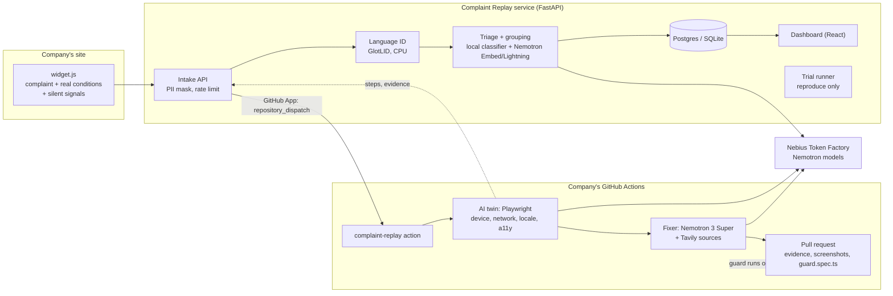

# Complaint Replay: plan for the real product

Written Oct 16, 2026. Status: **draft for approval**. Nothing gets built until the user says yes.
Deadline: Oct 30, 2026, 10:00 am PDT (10:30 pm IST). We submit on **Oct 29**. That leaves 13 working days.

v0 (what exists) is the child: it works on our own demo shop, with 5 fixed conditions and 7 bug types.
This plan builds the parent: a tool a real web team can point at its own app this week.

---

## 1. The product in one paragraph

Complaint Replay turns a vague user complaint ("payment page is stuck", "OTP nahi aa raha", "الزر لا يعمل")
into a pull request. A small widget on the company's site collects the complaint and the user's real
conditions: device, screen, network, language, timezone, zoom, color scheme. An AI twin then replays the
complaint in a real browser under those exact conditions against the company's staging or preview site. It
proves the bug with machine evidence only, writes the smallest fix with NVIDIA Nemotron, proves the fix with a
second replay, and opens a GitHub pull request that carries the evidence, before/after screenshots and a
Playwright guard test. From then on, that guard test runs in the team's own CI on every push. The person who
complained sees "we found it and fixed it".

**Who it is for.** Web teams of 5-50 people whose users are on devices, networks and languages the team never
tests on: e-commerce, fintech, SaaS, education and government services, above all in India, South-East Asia,
Africa, the Middle East and Latin America. Also support teams buried in "it doesn't work" tickets that
developers close as "can't reproduce" (13-24% of bug reports, per the ICSME 2020 study already in the README).

**Why they would adopt it.**
- Setup takes under 10 minutes: one script tag, one GitHub App install, one workflow file. Self-host is one
  `docker compose up`.
- It hands back a PR plus a test, not another dashboard to read. It fits the review flow the team already has.
- The replay runs inside **their** GitHub Actions, so their source code never reaches our server, and the
  compute is free for them on public repos and within their minutes on private ones.
- It is open source (Apache 2.0), so they can read exactly what touches their code.

**Why they would pay later** (not built in v1). Hosted plan priced per replay above a free tier; team features
(SSO, audit log, data residency); a support-desk integration (Zendesk, Intercom, email inbox).

---

## 2. Competitors, honestly

Searched Oct 16, 2026. Vendor claims are marked as such; I did not test these products.

| Group | Who | What they do well | What they don't do |
|---|---|---|---|
| Error-based AI fixing | **Sentry Seer** | Root cause from stack traces, opens PRs, adds unit tests, can hand off to Claude/Copilot/Cursor. Huge install base. About $40 per active contributor per month (May 2026). | Starts from an exception. Bugs that throw nothing (button off screen on a 360 px phone, error shown in English to a Hindi user, wrong total) never reach it. It does not replay a user's device, network or language. |
| AI on session replay | **PostHog Replay Vision** (GA Aug 2026, paid), **LogRocket Galileo** | Real sessions at scale, frustration scores, summaries, ranking of struggles. | Needs every session recorded (privacy, cost). They explain what happened; they don't reproduce under the user's conditions, fix, or leave a test behind. |
| Bug-report widgets | **Jam, Gleap, Marker.io, Userback** | Capture console, network, replay and environment with each report. Gleap adds AI triage and duplicate detection; its Pro plan lists a code feature ("Kai Code", vendor page). | A human still has to reproduce and fix. Reports from non-technical users stay vague. |
| AI QA platforms | **Momentic, QA Wolf, qa.tech** and others | Generate and self-heal E2E tests from plain language; some check accessibility. | They test what the team thinks of. Conditions and personas are not driven by real complaints. No search found slow-network or locale personas in Momentic or QA Wolf. |
| Reproduction agents | **Metabase Repro-Bot** (open source, internal), **ReBug** (research, Aug 2026), Relevance AI template | Repro-Bot reproduces GitHub issues with Playwright in a sandbox and writes a failing test. ReBug reproduced **49.96%** of 667 real reports from Ghost, Metabase, NocoDB and n8n (GPT-5 mini), against 31-41% for browser-use. | Repro-Bot does not fix, by design, and is built for Metabase only. ReBug is a paper, not a product. Neither uses the reporter's real device, network or language. |
| Coding agents | Copilot coding agent, Devin, Cursor, Claude Code | Strong at writing code once told what is wrong. | They need a precise task. We produce exactly that task, with proof. Phase 2 can hand off to them, as Seer does. |

**The gap we fill:** nobody ships the whole chain *user's own words + user's real conditions → machine-proven
reproduction → fix → proof → guard test in CI*. Each part exists somewhere. The chain, and the "conditions
come from the real user" part, do not.

**Where we are weak, said plainly:**
- ReBug's 50% on real reports is a sober ceiling. Our 21/21 is on bugs we planted. Expect a much lower number on
  real apps, and publish it anyway (section 4, task 1.8).
- Sentry and PostHog already sit in thousands of apps. We must integrate with them (Phase 2), not fight them.
- One builder, 13 days.

ReBug's main failure cause, element grounding (60-74% of failures), tells us where to spend effort: better
element targeting (accessibility tree + visible text + screenshot) beats a bigger model.

---

## 3. Architecture

### Components (each reuses v0 code where it can)

| Component | What it does | Reuses from v0 |
|---|---|---|
| `widget/` | One script tag. "Report a problem" button in the site's language (auto from `navigator.language`), RTL aware. Captures: viewport, DPR, UA, languages, timezone, connection type and RTT, color scheme, reduced motion, pointer type, zoom, page path, last 20 clicks (button names only, never typed values), console errors, failed request URLs. Silent signals: rage clicks, dead clicks, JS errors, slow requests. Shows the reporter the status of their report. | `server/widget.js` |
| Intake API (`server/`) | Projects, API keys per project, GitHub login, complaint intake, PII masking, rate limits, case store, status page per report, results upload from the Action. | `server/app.py` |
| Language ID | GlotLID (fastText, 2102 labels, CPU) tags each complaint's language and script. | new |
| Triage + grouping | Local CPU classifier: bug / UX confusion / feature request / spam. Grouping: Nemotron Embed + Lightning verifier. Impact score ranks the board. | `replay/grouping.py` |
| Conditions engine | Builds the twin from the widget data, or from named profiles: every Playwright device descriptor (100+ phones, tablets, desktops), network profiles (offline, 2G, slow 3G, 4G, high-latency satellite, flaky with random request failures), any locale + timezone + geolocation, RTL, dark mode, forced colors, reduced motion, 200% zoom, keyboard only, screen reader (accessibility tree only). | `replay/conditions.py` |
| Evidence collectors | Code watches the browser. Keep the 8 kinds; add: slow request, broken image/asset, layout overflow (horizontal scroll, clipped text), element covered or off screen, untranslated text (GlotLID on visible text vs page locale), wrong number/date/currency format for the locale, RTL mirroring errors, form that never submits, stuck spinner, redirect loop, auth expired, Core Web Vitals over budget, visual diff against a reference run. A screenshot check by a Nemotron vision model is allowed as **low-trust** evidence that can never decide a verdict alone. | `replay/browser.py` |
| Twin (navigator + judge) | Same loop as v0 with better element targeting: accessibility tree + visible text + bounding boxes, with retry on a blocked click. Login via a saved Playwright `storageState` or test credentials in repo secrets. | `replay/agent.py`, `replay/llm.py` |
| Fixer | Works on a real git checkout. Picks files by evidence: grep for the URL path, selector text and error string, then Nemotron Embed over the repo for the rest. Writes the patch, applies it, re-runs the twin. | `replay/fix.py`, `replay/research.py` |
| Guard | Exports the reproduction steps as a standard Playwright `guard-<case>.spec.ts` (with the same device, network and locale settings), added to the PR. Must pass on the fix and fail on the old code. | `replay/guard.py` |
| GitHub Action | `uses: yashasviyadav30/complaint-replay@v1`. Starts the app (the team's command) or uses a preview URL, runs twin → fix → proof → guard, opens the PR with `gh`. | new |
| CLI | `crp replay "complaint" --url ... --device "Galaxy A14" --network slow-3g --locale ar-EG`, `crp auth` (records a login), `crp init` (writes the workflow file). Same engine, local. | `pipeline.py` |
| Dashboard | Onboarding wizard, project list, board sorted by impact score, case detail (evidence, steps, screenshots, diff, PR link), trial page. | `dashboard/` |
| Self-host | One `docker-compose.yml`: API + dashboard + Postgres. The Action points at it. | new |

### Where each model runs

| Job | Model | Runs on | Why |
|---|---|---|---|
| Language ID | GlotLID v3 (fastText) | Our server, CPU | 2102 labels, fast, free, no API call |
| Triage (bug / UX / feature / spam) | Small classifier on multilingual embeddings, **trained on this laptop** | CPU | Cheap, honest on-device training; data in Phase 1 task 1.6 |
| Grouping | Nemotron Embed + Nemotron 3.5 Lightning check | Token Factory | Already calibrated (P0.82 R0.58); recalibrate on the multilingual set |
| Navigator, judge | Nemotron 3 Super, thinking off | Token Factory | Proven in v0 |
| Screenshot check (low trust) | Nemotron Nano Omni or VL | Token Factory | Confirm the id on the live catalog first; drop if absent |
| Fixer | Nemotron 3 Super, reasoning on; Nemotron 3 Ultra on a second try | Token Factory | Root-cause reasoning |
| Web research | Tavily | API | Cites sources; Tavily prize |
| Fine-tuned navigator | Small Nemotron trained on our replay traces | Nebius AI Cloud, Phase 3 | Needs credits and data we don't have yet |

Honest limit: the laptop (AMD 780M, no NVIDIA GPU) can train small classifiers and run fastText and small
embedding models. It cannot run or train a model that drives a browser or writes fixes.

### Hosting at ₹0

- **Replays and fixes:** the customer's GitHub Actions. Ubuntu runners ship with what Playwright needs; free
  for public repos. Our own demo runs in our public repo's Actions.
- **Dashboard:** static build on GitHub Pages or Cloudflare Pages (no card).
- **API:** first choice a small Nebius AI Cloud VM paid from credits, *if* the card problem is solved (it also
  satisfies "runs on Nebius AI Cloud"). Fallback: a free web service (Render free tier: sleeps after 15 minutes
  idle, 512 MB; check the current terms on day 1, since sources disagree). The API is light because no browser
  runs there.
- **Database:** SQLite for self-host; Neon or Supabase free Postgres for the hosted API (no card; check day 1).
- **Trial runner:** reproduce-only replays for people without a GitHub repo, run as a GitHub Actions job in
  our public repo, with a daily cap.

The demo must stay live through judging (Dec 1-15). Free web services sleep; the first request after sleep is
slow. Say so in the README and add a "waking up" state to the dashboard.

### Privacy and security (not optional, even in v1)

- Widget never sends typed values. Phone numbers, emails, card-like and ID-like numbers are masked before
  storage and before any model call (v0 regex, extended to more formats and scripts).
- Source code stays in the customer's CI in the Action mode. Only evidence summaries, steps and screenshots
  come back, and screenshots can be turned off per project.
- Retention setting per project (default 30 days), enforced by a daily delete job.
- Fixes only ever land on a new branch and a PR. Never the default branch, never a deploy.
- The fixer may only edit files inside the repo; paths are checked (v0 already rejects unsafe edits).
- Trial runner abuse (using us to hammer someone else's site): a URL is replayed only if our widget snippet is
  present on it (proves the person controls the site), private IP ranges are blocked, step and time caps,
  per-IP rate limits.
- Secrets: model keys live in repo secrets or server env, are never logged, never sent to the browser.
- Prompt injection: page text is untrusted data. The navigator can only choose actions from a fixed list; the
  fixer's output is a patch that a human reviews in the PR.

---

## 4. Phases

### Phase 1: real v1, submitted (Oct 16 → Oct 29)

**Goal:** a team that is not us can point Complaint Replay at its own web app and get a PR with a guard test,
in any language and under any common device/network condition, with a free trial and a self-host option.

Each block ends with a **gate**. If a gate fails, apply the cut list in section 7 before moving on.

| Dates | Task | Acceptance check |
|---|---|---|
| **Oct 16** | 1.0 Plan approved. Install Context7 and Playwright MCP servers. Ask in the Nebius Discord about the card problem (user). Check hosting and DB free tiers. | Plan approved; MCPs connected; Discord message sent by the user. |
| **Oct 17-18** | 1.1 **Any URL.** Project = target URL + optional login state + optional repo. Twin runs against any site. `crp auth` records a login with Playwright and stores it encrypted. Better element targeting (a11y tree + text + boxes, retry blocked clicks). | `crp replay` reproduces 3 known bugs on a second app we did not write (picked on Oct 17, see 1.8), one behind a login. |
| | 1.2 **Conditions engine.** Playwright device catalog, network profiles incl. flaky, locale/timezone/geolocation, RTL, dark mode, forced colors, reduced motion, zoom, keyboard-only, screen reader. Widget sends the new fields; `twin_condition` maps them. | Unit tests per profile; a scripted check that an Arabic RTL twin, a 2G twin and a keyboard-only twin each behave as set. |
| **Gate Oct 18** | Twin works on a foreign app with login. | If not: stop adding conditions, fix targeting first. |
| **Oct 19-20** | 1.3 **Evidence collectors.** The new kinds in section 3, each with a scripted browser test on a tiny fixture page (BadShop gets the planted cases). | Each collector fires on its fixture and stays silent on the clean page (false alarm check). |
| | 1.4 **Fix on a real repo + PR.** File selection by evidence + embeddings, patch on a git branch, proof replay, guard exported as `guard-<id>.spec.ts`, PR opened with `gh` with evidence, screenshots, sources, diff summary. | One real PR opened on a test repo from a complaint, guard passes on the branch and fails on main in CI. |
| **Gate Oct 20** | A PR with a guard test exists on a repo that is not BadShop. | If not: v1 ships "reproduce + guard test + suggested patch in the issue", no auto-PR. |
| **Oct 21-22** | 1.5 **GitHub Action + GitHub App + hosted API.** `action.yml`; GitHub App (created by the user from a manifest we prepare) sends `repository_dispatch`; Action posts results back. API: GitHub login, projects, widget keys, status per report, retention job. Docker Compose self-host. | Fresh repo: install app, add one script tag and one workflow file, file a complaint in the widget → PR appears. Timed: under 10 minutes for setup. |
| | 1.6 **Any language.** GlotLID in intake. Multilingual complaint set: the 57 v0 complaints + new ones in ~20 languages and scripts (Arabic, Bengali, Tamil, Indonesian, Swahili, Portuguese, Spanish, Vietnamese, Turkish, Russian, Japanese...), written with Nemotron and **marked synthetic**, plus a small hand-checked real slice. Train the triage classifier on CPU; recalibrate grouping; report held-out numbers per language family. Widget UI strings in those languages. | Held-out precision/recall table in the README, with the synthetic caveat. |
| **Gate Oct 22** | Setup-to-PR works end to end on a fresh repo. Token Factory key decision made (target Oct 22, hard stop Oct 25). | If the app/dispatch path fails: the Action runs on a 10-minute schedule and pulls new cases (no app needed). |
| **Oct 23** | 1.7 **Dashboard v1.** Onboarding wizard (copy snippet, install app, add workflow, send a test complaint), project switcher, board by impact score, case detail with PR link, trial page, "waking up" state, dark/light, mobile layout. design-taste-frontend first, web-design-guidelines review after. | Guideline review clean; Lighthouse accessibility ≥ 95; works at 360 px. |
| | 1.9 **Close the loop + sector packs.** Reporter status in the widget and a status link. Sector pack = a small config of default conditions, extra checks and PII strictness: e-commerce, fintech (amount consistency, duplicate charge), public sector/health (WCAG checks, strict PII, screenshots off). | Reporter sees "reproduced → fix ready" for a real case; each pack has one test. |
| **Oct 24** | 1.8 **Trust benchmark on real bugs.** Pick 1-2 open-source web apps that run locally without heavy services (candidates: Excalidraw and one more, checked Oct 17). Take ~15-20 real, closed UI issues with known fix commits; check out the commit before each fix; replay the issue text; compare our fix with the real one; run the guard. Plus BadShop bench re-run. Public results page. | `results/real-bugs.md` with every run, misses included. No cherry-picking. |
| **Oct 25** | 1.10 Deploy hosted API + dashboard + trial. Bench on **Token Factory** (if the key exists). Security review (security-reviewer agent) and fixes. README rewrite for judges: setup in 10 minutes, how Nemotron and Token Factory are used. | Live URL works from a phone on mobile data. Security review: no CRITICAL/HIGH left. |
| **Oct 26-27** | 1.11 Video (section 5), write-up, feedback section, architecture diagram (archify). | Video ≤ 3:00, captions, real footage only. |
| **Oct 28** | 1.12 Freeze. Full fresh-machine run through the README. Fix only what breaks. | Someone else (family member or friend) follows the README and gets a PR. |
| **Oct 29** | Submit. User clicks Submit on Devpost, uploads the video to YouTube (public). | Submitted with a day to spare. |

**Risks in Phase 1**
- *Token Factory key never arrives.* The rules require a Token Factory call. Fallbacks in order: Discord help;
  free virtual Visa debit from a zero-balance account; ask organisers for an exception in writing. If nothing
  by Oct 25: submit on the NVIDIA endpoint, say so plainly in the README, and accept the risk. Never enter card
  details for the user.
- *Real-app reproduction is much weaker than on BadShop.* Expected. Publish the true number; it is a
  credibility point with judges, not a hiding point.
- *Free host limits* (sleep, 512 MB). No browser runs on the API host, so it fits; replays run in Actions.
- *GitHub Actions minutes* for private repos cost the customer minutes. Show the minutes per replay on each case.
- *Scope.* This is a lot for one person. The gates and the cut list are the safety net.

**What the user must do in Phase 1**
| By | Action |
|---|---|
| Oct 16 | Approve or edit this plan. Post in the Nebius Discord about the RuPay card. |
| Oct 18 | Pick the product name (Complaint Replay or Black Campus/Compass); it goes into the app, video and repo. |
| Oct 21 | Create the GitHub App from the manifest link we prepare (one click on github.com, your account). |
| Oct 22 | Sign up for the chosen host and database with GitHub login (no card). |
| Oct 22-25 | Token Factory key: set `NEBIUS_API_KEY` in `.env` once you have it. |
| Oct 24 | Choose the voice for the video: your recorded voice sample or captions only. |
| Oct 29 | Upload the video to YouTube, paste the write-up into Devpost, click Submit. |
| After Oct 30 | Rotate the NVIDIA and Tavily keys that were pasted in chat. |

### Phase 2: stay live and get first users (Oct 30 → Dec 15)

Judging runs Dec 1-15, so the demo must stay up and stable.
- Hand off big fixes to an external coding agent (Copilot coding agent, Claude Code Action) with our evidence
  as the task, the way Seer does. Our job stays: reproduce, prove, guard.
- Ingest more sources: Sentry and PostHog events as silent signals; support desks (email inbox, Zendesk,
  Intercom); app-store and Reddit complaints through Tavily.
- Slack, Jira, Linear and GitHub Issues links.
- Bring-your-own key and bring-your-own model (any OpenAI-compatible endpoint).
- Five design partners: small teams from the hackathon community and Indian startups. Track time-to-first-PR
  and how many PRs get merged.
- **Acceptance:** 5 outside teams installed it, at least 10 PRs merged by people who are not us.

### Phase 3: mobile and scale (Jan → Mar 2027)

- Native Android apps: emulator in GitHub Actions (Linux runners support KVM), Appium or Maestro as the driver,
  the same evidence model. iOS later (needs macOS runners, costly).
- Parallel replays on Nebius Serverless jobs for teams with heavy traffic.
- Fine-tune a small Nemotron navigator on Nebius AI Cloud from consented replay traces; measure against
  Nemotron 3 Super on the real-bug benchmark.
- Learn new bug classes: an evidence plugin API (a Python entry point per collector), so a team can add a
  check for its own domain (for example "invoice total matches line items").
- **Acceptance:** the real-bug benchmark beats ReBug's 50% on the same kind of reports, or we publish why not.

### Phase 4: more sectors and compliance (Apr 2027 →)

- Sector packs with real rules: payments (idempotency, PCI-safe capture), health (HIPAA-style data handling,
  self-host only), government (WCAG 2.2 AA, Indian GIGW, EU accessibility act checks), education (low-end
  devices, offline).
- Data residency (EU, India) for the hosted plan; SSO; audit log. Paid plans start here.

---

## 5. Judging criteria and the 3-minute video

Four criteria, equal weight; Technological Implementation breaks ties.

| Criterion | How we earn it | Proof we show |
|---|---|---|
| Technological implementation | Machine-only evidence; twin from real conditions; fix proven by a second replay; guard test that fails on old code; runs in the customer's CI; GlotLID + CPU-trained classifier + four Nemotron jobs on Token Factory; security review. | Real-bug benchmark with misses; test suite; architecture diagram; README "how Nemotron and Token Factory are used". |
| Design | Setup in 10 minutes with a wizard; PR description a reviewer can read in 30 seconds; widget in the user's language and direction; clean board. | Timed setup in the video; screenshots of the PR. |
| Potential impact | Billions of users on cheap phones, slow networks and non-English languages hit bugs nobody on the team can see. Fixes reach them in days, not never. Any sector, any country. | Arabic + Hindi + slow-network cases in the video; real-bug numbers; open source and free self-host. |
| Quality of idea | "Your users already told you what's broken" → a PR with proof. The full chain is new (section 2). | Competitor table in the write-up. |

**Video plan (≤ 3:00, real footage only)**
| Time | Shot |
|---|---|
| 0:00-0:20 | A real-looking complaint in Arabic on a cheap phone; the developer on a laptop: "works for me". |
| 0:20-0:50 | Setup on a fresh repo: script tag, install the GitHub App, add the workflow. A timer on screen. |
| 0:50-1:40 | A complaint arrives. The twin replays it as a 360 px Arabic phone on slow 3G; evidence appears; Nemotron writes the fix; the proof replay passes. |
| 1:40-2:10 | The PR: evidence, before/after screenshots, guard test, CI green on the fix and red on main. The reporter's widget shows "fixed". |
| 2:10-2:40 | Same thing on a real open-source app's bug; the real-bug results table, misses included. |
| 2:40-3:00 | Built on Nemotron via Nebius Token Factory, Tavily; open source; try it at <URL>. |

Reuse the v0 HyperFrames project (`video/film/`) and recorder (`scripts/record_demo.py`). Voice: the user's
recorded voice or captions only, decided Oct 24.

---

## 6. Claude Code skills, plugins and agents per phase

Already installed: `ecc`, `mattpocock-skills`, `ponytail`, HyperFrames skills, `plain-english`,
`design-taste-frontend`, `web-design-guidelines`, `hackathon-submit`, `archify`, `dataviz`, Chrome DevTools MCP,
Claude in Chrome.

**Install on Oct 16 (they clearly help):**
- **Context7 MCP**: current docs for Playwright, FastAPI, GitHub Actions and GitHub Apps. `ecc:docs-lookup`
  depends on it and it is not connected today.
- **Playwright MCP**: lets `ecc:e2e-runner` and `ecc:gan-evaluator` drive the dashboard and widget in tests.
  Not connected today.

I'm not adding more than these two. Thirty plugins would slow every session and overlap with what `ecc`
already has; I'll add one later only when a task proves it needs it.

| Phase 1 task | Use |
|---|---|
| Planning each block | `ecc:planner`, `ecc:architect` for the Action/App/API boundary |
| 1.1-1.4 engine (Python) | `mattpocock-skills:tdd`, `ecc:python-testing`, `ecc:python-reviewer`, `ecc:fastapi-patterns`, `ecc:e2e-testing` |
| 1.4-1.5 PR, Action, App | `ecc:github-ops`, `ecc:git-workflow`, `ecc:deployment-patterns`, `ecc:docker-patterns`, `ecc:docs-lookup` (Context7) |
| 1.6 languages + classifier | `ecc:mle-workflow`, `ecc:eval-harness`, `ecc:mle-reviewer` |
| 1.7 dashboard | `design-taste-frontend`, `ecc:react-patterns`, `ecc:react-reviewer`, `ecc:accessibility`, `web-design-guidelines`, `ecc:browser-qa` |
| 1.8 benchmark | `ecc:benchmark-methodology`, `dataviz` for the results page |
| 1.10 hardening | `ecc:security-reviewer`, `ecc:silent-failure-hunter`, `ecc:code-reviewer` after each block |
| 1.11 submission | `hackathon-submit`, `hyperframes` + `general-video`, `archify`, `plain-english` |
| Phase 2 | `ecc:api-connector-builder` (Sentry, PostHog, Zendesk), `ecc:market-research`, `ecc:product-lens` |
| Phase 3 | `ecc:pytorch-patterns`, `ecc:mle-workflow` for fine-tuning on Nebius |

Agents run in parallel only where work is independent (for example a reviewer on block 1.3 while I build 1.4).

---

## 7. Cuts, in the order we drop them

If a gate fails or a day slips, cut from the top.

1. Sector packs (keep only fintech: it has the strongest demo, the double charge).
2. Screenshot check by a vision model.
3. Visual-diff evidence.
4. Hosted trial runner for people without a repo (keep the recorded demo on GitHub Pages instead).
5. GitHub App (the Action polls on a schedule instead).
6. Multilingual widget UI beyond 6 languages (keep English, Hindi, Arabic, Spanish, Portuguese, Indonesian).
7. Second real app in the benchmark (keep one).
8. Hosted API (self-host + CLI + Action only, plus the static demo).

**Never cut:** the Token Factory call, machine-only evidence, the guard test, PII masking, the real-bug
benchmark with misses, the README setup path, the video.

---

## Sources

- Sentry Seer: https://docs.sentry.io/product/ai-in-sentry/seer, https://sentry.io/cookbook/self-healing-workflow-seer/
- PostHog Replay Vision: https://www.createwith.com/tool/posthog/updates/posthog-replay-vision-enters-general-availability-adding-ai-to-session-replays
- LogRocket alternatives (PostHog's own page, biased): https://posthog.com/blog/best-logrocket-alternatives
- Bug widgets (Gleap's own roundup, biased): https://www.gleap.io/blog/best-in-app-bug-reporting-tools-2026, https://www.gleap.io/alternatives/alternative-to-marker-io
- AI QA tools: https://qa.tech/blog/best-agentic-qa-tools-in-2026.md, https://qaskills.sh/blog/momentic-ai-testing-guide-2026
- Metabase Repro-Bot: https://www.metabase.com/blog/reprobot-github-issue-triage-agent
- ReBug paper: https://arxiv.org/html/2608.03598v1
- GlotLID: https://github.com/cisnlp/GlotLID, https://arxiv.org/pdf/2310.16248
- Nemotron prices on Nebius (third-party listing, verify on Nebius): https://custom.typingmind.com/tools/estimate-llm-usage-costs/nebius/nemotron-3-super-120b-a12b
- Free hosting (third-party, sources disagree): https://snapdeploy.dev/state-of-free-hosting, https://costbench.com/software/developer-tools/render/free-plan
